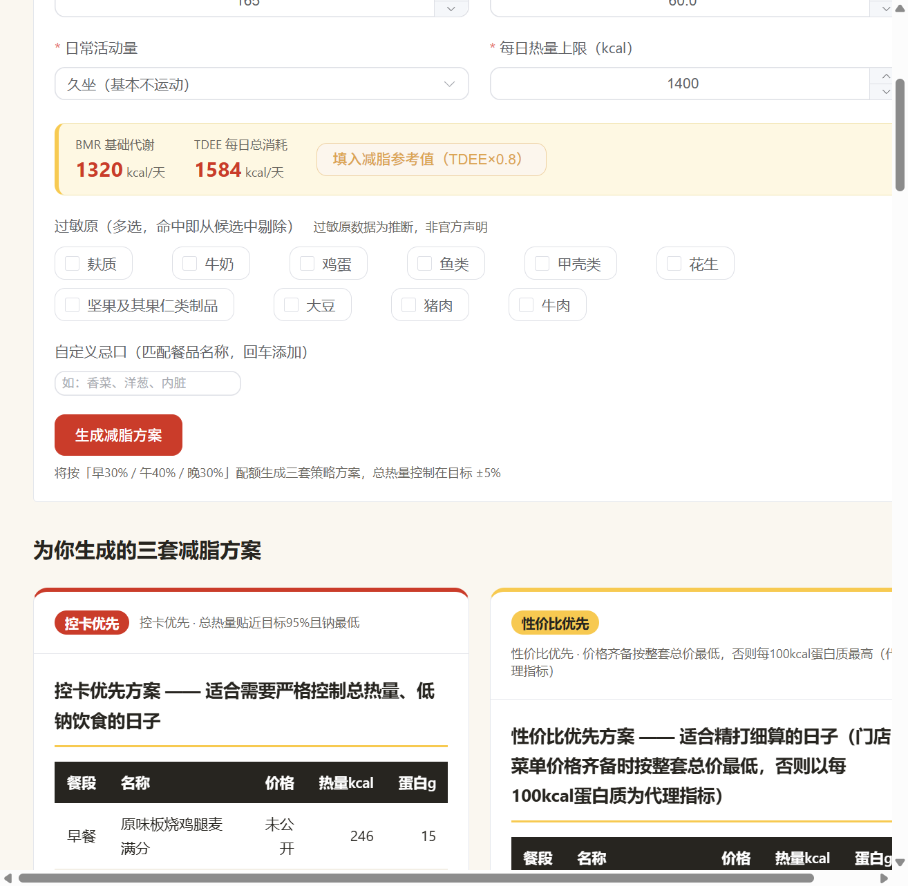

# 麦门减脂营养师（MC Nutrition Expert）

> 麦当劳程序员节创意开发大赛参赛作品 · 基于麦当劳 MCP 官方餐品数据能力的减脂配餐 Web 应用

减脂期也想吃麦当劳？填写身高体重、活动量与忌口，应用基于 **麦当劳 MCP 官方接口 `list-nutrition-foods`（160 个单品真实营养数据）** 自动过滤过敏原餐品，生成 **3 套总热量严格控制在目标 ±5% 的早+午+晚麦当劳套餐**，横向对比、一键替换，全程 Markdown 表格输出。

> ⚠️ 本项目为参赛者独立开发的参赛作品，非麦当劳官方产品；输出仅供参考，不构成医疗或营养专业建议；餐品信息、价格及供应状态以麦当劳官方渠道实时结果为准。详见 [CONTEST_DECLARATION.md](./CONTEST_DECLARATION.md)。

## ✨ 功能特性

1. **官方营养数据源 + 门店真实价格**：菜单数据由构建期脚本 `scripts/fetch-mcp-data.mjs` 在线调用麦当劳 MCP `list-nutrition-foods` 拉取，覆盖 160 个单品的能量/蛋白质/脂肪/碳水化合物/钠官方实测值；并通过 `query-nearby-stores` + `query-meals` 接入上海徐家汇餐厅（storeCode 1450034）在售菜单现价（currentPrice），按名称规范化匹配填价（宁缺勿滥，未匹配单品显示"未公开"）。
2. **用户信息收集**：性别、身高、体重、日常活动量、每日热量上限、过敏原（10 类多选）与自定义忌口；必填项缺失逐项中文引导补齐，并实时展示 BMR/TDEE 参考值（Mifflin-St Jeor 公式）辅助设定热量目标。
3. **过敏原/忌口自动过滤**：配餐前剔除命中用户过敏原或忌口关键词的餐品；过敏原为名称关键词推断数据（MCP 营养接口不含过敏原字段），全程标注"非官方声明"。
4. **三套控卡方案**：控卡优先（热量近下限+低钠）/ 性价比优先（单品价格齐备时按整套真实总价最低，否则回退每 100kcal 蛋白质代理指标）/ 饱腹感优先（蛋白+脂肪+克重最高），每套总热量严格落在目标 ±5%，早餐仅从早餐餐段选取。
5. **Markdown 输出**：餐品清单表格（餐段/名称/价格/热量/蛋白/碳水/脂肪/钠）+ 分割线 + 整套总价（门店菜单全部收录时输出真实合计）/总热量 + 三大营养素汇总与供能比，前端整齐渲染。
6. **横向对比板块**：3 套方案营养与价格对比表，标注各自适用场景。
7. **额外指令**：按名称查询任意单品完整营养；"不喜欢→自动替换"为同分类、同餐段、热量 ±10% 且整套仍达标的其他单品，支持还原。

## 🛠 技术栈

Vue 3.5 · Vite 6 · Element Plus 2.9 · marked 15（纯前端 SPA，无后端依赖）

## 📦 安装与运行

```bash
# 环境要求：Node.js >= 18（脚本使用 Node 24 验证）
npm install
npm run dev      # 本地开发，默认 http://localhost:5173
npm run build    # 生产构建，产物在 dist/

# 可选：重新从麦当劳 MCP 拉取官方营养数据 + 门店在售菜单价格并再生快照
#（需先在 .env 配置 MCD_MCP_URL/MCD_MCP_TOKEN；--meals-cache <path> 可用缓存的 query-meals 响应离线回退价格步骤）
node scripts/fetch-mcp-data.mjs
```

## 📖 使用示例

1. 打开页面，填写：女 / 165cm / 60kg / 久坐 / 每日热量上限 1400 kcal / 过敏原勾选"牛奶"；
2. 点击"生成减脂方案"，得到 3 套方案卡片（基于 MCP 官方数据实测总热量 1330 / 1391 / 1465 kcal，均在 ±5% 内，蛋白质 120 / 127 / 123 g，且不含牛奶过敏原餐品）；整套总价仅当方案内全部单品被门店菜单价格收录时显示真实合计（如 巨无霸 ¥26.5、板烧鸡腿堡 ¥23.5、麦辣鸡腿汉堡 ¥22.5），本演示方案的早餐主食未收录故显示"未公开"；
3. 查看底部横向对比表，选定心仪方案；
4. 对方案中某单品点"不喜欢→自动替换"，系统换成同类型、热量差 ≤10% 的在售单品并实时重算汇总；
5. 在"单品营养查询"中搜索"麦香鱼"，查看其完整营养数据。

完整实测输出见 [demo-output.md](./demo-output.md)。

## 🖼 运行效果




## 🎯 目标用户

- 减脂/控卡期仍想在麦当劳就餐的人群；
- 对特定过敏原或忌口有过滤需求的麦当劳顾客；
- 关注高蛋白、低钠饮食搭配的健身人群；
- 希望快速了解麦当劳单品营养价值的普通消费者。

## 📁 项目结构

```
├── scripts/
│   └── fetch-mcp-data.mjs            # 构建期脚本：在线调用麦当劳 MCP list-nutrition-foods + query-nearby-stores/query-meals 生成含价格的数据快照（Token 仅从 .env 读取）
├── src/
│   ├── data/
│   │   ├── mcdonalds-menu.json               # 麦当劳 MCP 官方营养数据快照（160 个单品，含门店菜单匹配价格，由 fetch-mcp-data.mjs 生成）
│   │   └── mcdonalds-menu.website-backup.json # 旧官网数据快照备份（91 个单品）
│   ├── services/mcpClient.js         # 统一数据入口（读取快照，可无缝替换为 MCP 在线调用）
│   ├── utils/
│   │   ├── nutrition.js              # BMR/TDEE 计算
│   │   ├── planGenerator.js          # 三策略套餐生成（±5% 热量约束）
│   │   ├── substitute.js             # 单品替换与还原
│   │   └── markdownOutput.js         # Markdown 表格输出
│   └── components/                   # 表单 / 方案卡片 / 对比面板 / 单品查询
├── demo-output.md                    # 三套方案实测输出（MCP 数据源）
├── CONTEST_DECLARATION.md            # 参赛声明（官方原文）
├── MCP_INTEGRATION.md                # 麦当劳 MCP Server/Tool/调用流程说明
└── .trae/specs/                      # Spec 驱动开发的过程文档（spec/tasks/checklist）
```

## 🔌 MCP 集成与数据口径

本项目数据源为**麦当劳 MCP 官方接口**：构建期由 `scripts/fetch-mcp-data.mjs` 在线拉取 `list-nutrition-foods` 的 160 个单品官方营养数据，并调用 `query-nearby-stores` + `query-meals` 获取上海徐家汇餐厅（storeCode 1450034，24 小时营业）在售菜单 currentPrice，按名称规范化匹配填价（59/160 条命中，未匹配单品显示"未公开"）生成快照（Token 仅在构建时从 `.env` 读取，浏览器端零 Token 暴露并规避 CORS）。与旧官网快照交叉校验：可按名称匹配的 86 条中 97.7% 五项数值完全一致。过敏原仍为名称关键词推断（非官方声明）。**价格口径注意**：`query-meals` 依赖门店营业时间（普通门店打烊后返回 600057"不在营业时间"，故选用 24 小时门店；脚本支持 `--meals-cache` 离线回退）；价格随门店与时间浮动，且为单品现价合计，不含套餐/优惠券组合价（`calculate-price` 未接入），下单前以官方渠道实时结果为准。接入方式、35 个工具清单与切换方案详见 [MCP_INTEGRATION.md](./MCP_INTEGRATION.md)。

## 🏆 活动信息

- 活动仓库：[M-China/mcd-developer-innovation-challenge](https://github.com/M-China/mcd-developer-innovation-challenge)
- 麦当劳 MCP 开放平台：https://open.mcd.cn/mcp
